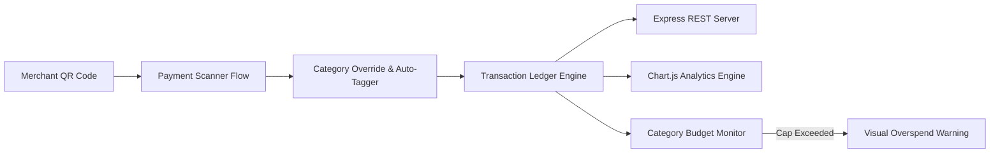

# 💳 SBETS — Smart Business Expense Tracker System

A full-stack personal and small-business expense tracking platform featuring simulated UPI/QR payment flows, automated merchant categorization, real-time analytics, and category-level budget management.

---

## ⚡ Key Capabilities

- **Simulated QR / UPI Checkout:** Scan merchant QR codes with interactive payment flows and real-time category selection (Food, Transport, Utilities, Equipment, etc.).
- **Spending Analytics & Insights:** Dynamic category breakdown, monthly expense trends, and instant budget utilization tracking.
- **Category Budget Thresholds:** Set spending limits per category with visual progress alerts before you overspend.
- **Transaction History:** Searchable, filterable transaction ledger with full editing and deletion support.
- **Responsive UI:** Dark-mode fintech interface built with custom CSS animations and tactile feedback.

---

## 📐 System Flow & Architecture



---

## 🛠️ Tech Stack

- **Frontend:** HTML5, CSS3, Vanilla JavaScript (ES6+), Chart.js
- **Backend:** Node.js, Express (`server.js`)
- **API & Middleware:** Express JSON parser, CORS
- **Storage:** LocalStorage client caching with backend REST endpoints

---

## 🚀 Quick Start

### 1. Prerequisites
- Node.js (v18 or higher recommended)

### 2. Installation & Setup
```bash
# Clone the repository
git clone https://github.com/NodeNexus/SBETS.git
cd SBETS

# Install dependencies
npm install

# Start the Express server
npm start
```

### 3. Open the Dashboard
Navigate to `http://localhost:3000` (or `http://localhost:5000` depending on port configuration) in your browser.

---

## 📂 Project Structure

```
SBETS/
├── index.html            # Main dashboard and payment interface
├── script.js             # Client logic, payment simulation, and analytics
├── styles.css            # Base stylesheet and layout
├── enhancements.css      # Component styling and button interactions
├── final-polish.css      # Typography and responsive layout polish
├── server.js             # Express REST backend
└── package.json          # Node dependencies and scripts
```
